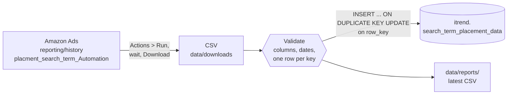

# Placement Search Term Automation


Every hour, this job downloads the Amazon Ads saved report **`placment_search_term_Automation`** ([report history](https://advertising.amazon.com/reporting/history?entityId=ENTITY1YST5GXMAIR36&reportId=79745ecf-57c1-48de-a3f7-51c1feab3658)) and **upserts** it into **`itrend.search_term_placement_data`**.

Each row is identified by **date + hour + marketplace + campaign + ad group + target + search term + placement**. That key is stored as a UNIQUE `row_key`, so a row is never stored twice. Running the same report again updates the existing rows instead of adding copies. Nothing is ever deleted.

---

## Contents

- [How it works](#how-it-works)
- [Quick start (Windows)](#quick-start-windows)
- [Running on a Linux server (cron)](#running-on-a-linux-server-cron)
- [Everyday commands](#everyday-commands)
- [The table](#the-table)
- [No duplicates: the rules](#no-duplicates-the-rules)
- [Is it working?](#is-it-working)
- [Configuration](#configuration)
- [Exit codes](#exit-codes)
- [Troubleshooting](#troubleshooting)
- [Project layout](#project-layout)
- [Development](#development)

---

## How it works



| Job | When | What it does |
| --- | --- | --- |
| **Amazon Placement Search Term** | Every hour at **:15** (IST) | Runs the saved report, waits for it, downloads the CSV, then upserts the rows. |

The task runs at :15 so its browser never starts together with the search term job, which runs at :45.

**First run:** if the table does not exist yet, it is created from the report's own columns (`DB_AUTO_CREATE_TABLE=true`). The SQL that was used is saved to `sql/create_search_term_placement_data.sql`.

---

## Quick start (Windows)

You need **Python 3.11+**, **[uv](https://docs.astral.sh/uv/)**, and network access to the itrend MySQL server.

```powershell
# 1. Install dependencies into .venv (already done on this PC)
uv sync
uv run playwright install chromium

# 2. Settings: .env is already filled in except DB_PASSWORD
notepad .env

# 3. Check the settings (no browser, no database)
uv run python run.py --check-config

# 4. One-time Amazon sign-in: a Chrome window opens; sign in and enter the OTP
uv run python run.py --login

# 5. One manual run: downloads the report, creates the table, upserts the rows
uv run python run.py --load

# 6. Schedule it (every hour at :15 IST)
powershell -ExecutionPolicy Bypass -File scripts\install_task_windows.ps1
```

| Option | Example |
| --- | --- |
| Run at a different minute | `install_task_windows.ps1 -Minute 30` |
| Remove the task | `install_task_windows.ps1 -Remove` |

> [!NOTE]
> The task runs while you are signed in to Windows. The Amazon session in `data\session` belongs to this Windows user.

---

## Running on a Linux server (cron)

```bash
uv sync --no-dev && uv run playwright install --with-deps chromium
cp .env.example .env && chmod 600 .env     # fill in DB_PASSWORD
chmod +x scripts/*.sh

python run.py --login                      # one-time sign-in (asks for the OTP)
scripts/install_cron.sh --print            # checks the setup and shows the cron line
scripts/install_cron.sh                    # installs it into your crontab
```

The installer converts :15 IST to the server's clock. On a UTC server the entry looks like this:

```cron
# Every hour at :15 IST (:45 UTC)
45 * * * * /path/to/project/scripts/run_placement_search_term.sh --load >> /path/to/project/logs/placement_search_term_cron.log 2>&1
```

> [!IMPORTANT]
> Schedule the job on **one machine only**. If you move it to a server, remove the Windows task with `install_task_windows.ps1 -Remove`.

---

## Everyday commands

| I want to… | Command | Writes to the DB? |
| --- | --- | --- |
| Run now (what the hourly task runs) | `uv run python run.py --load` | **Yes** |
| Run the whole flow but write nothing | `uv run python run.py --load --dry-run` | No |
| Download the report only | `uv run python run.py --save-reports` | No |
| Take the newest finished run instead of clicking Run | `uv run python run.py --load --latest` | **Yes** |
| Load a CSV I already downloaded | `uv run python run.py --process-file "C:\path\report.csv"` | **Yes** |
| See the CREATE TABLE a CSV would produce | `uv run python run.py --create-table report.csv --dry-run` | No |
| Create the table without loading | `uv run python run.py --create-table report.csv` | **Yes** (table only) |
| Check the `.env` settings only | `uv run python run.py --check-config` | No |
| Test the page selectors (clicks nothing) | `uv run python run.py --inspect-page --headed` | No |
| Sign in to Amazon again | `uv run python run.py --login` | No |

Every run ends with a summary like this one:

```text
  today     report     : data\reports\amazon_ad_placement_search_term_today.csv (18412 rows)
  today     covers     : 2026-11-20 [US]
  today     database   : upsert: 214 inserted, 18198 updated
  status             : SUCCESS
```

---

## The table

`itrend.search_term_placement_data` holds the report's own columns, renamed to snake_case, plus 4 extra columns:

| Column | Meaning |
| --- | --- |
| `id` | Auto-increment primary key. |
| *report columns* | For example `report_date`, `hour`, `campaign_id`, `campaign_name`, `ad_group_id`, `target_id`, `targeting`, `search_term`, `placement`, `impressions`, `clicks`, `total_cost`, `purchases`, `sales`, `cpc` and `ctr`. IDs are `BIGINT`, money and rates are `DECIMAL(20,6)`, and `ctr` stays a percentage (2.5 = 2.5%). |
| `report_id` | The Amazon saved report that the row came from. |
| `loaded_at` | UTC time of the last load that wrote the row. |
| `row_key` | SHA-256 of the natural key. It has a **UNIQUE** index. |

Known Amazon columns get fixed names and types, as listed in `KNOWN_COLUMNS` in `app/placement_processor.py`. Any other column gets a snake_case name, and its type is taken from its values.

---

## No duplicates: the rules

| Rule | What it means |
| --- | --- |
| **One row per key** | `row_key` = date + hour + marketplace + campaign + ad group + target + search term + placement, using only the columns the report has. It is UNIQUE in the table, so MySQL itself refuses a second copy. |
| **Upsert** | A key that is already stored gets the latest values (clicks, spend, sales …). A new key is inserted. |
| **Checked after every chunk** | After each insert, the number of rows with those keys must equal the number of keys. Otherwise the chunk is rolled back. |
| **Clean files only** | If two rows in one file share a key but have different numbers, the file is refused, nothing is written, and the log names the column that differs. Rows that are exact copies are simply dropped. |
| **Nothing is deleted** | A row that Amazon later drops from the report stays in the table. |
| **Stable key** | Once the table exists, its columns decide the key. If the report later loses a key column, the run stops instead of loading rows under a different key. |
| **One run at a time** | A run lock and the task's "do not start a new instance" setting prevent overlapping runs. |

---

## Is it working?

| Where to look | What you should see |
| --- | --- |
| `logs\placement_search_term_cron.log` | One `START` and one `END status=0 SUCCESS` line per hourly run. |
| `logs\placement_search_term_cron_last_run.log` | Output of the last run, ending with `status : SUCCESS`. |
| `logs\placement_search_term.log` | The full detailed log, rotated daily. |
| `data\reports\amazon_ad_placement_search_term_today.csv` | The last file that was loaded successfully. |
| Task Scheduler | *Last Run Result* `0x0` for *Amazon Placement Search Term*. |

A quick check in MySQL. The second query must return no rows:

```sql
SELECT report_date, COUNT(*) AS rows_, MAX(loaded_at) AS last_load
  FROM itrend.search_term_placement_data GROUP BY report_date ORDER BY report_date DESC LIMIT 7;

SELECT row_key, COUNT(*) FROM itrend.search_term_placement_data GROUP BY row_key HAVING COUNT(*) > 1;
```

---

## Configuration

All settings live in `.env`; copy it from `.env.example`. Environment variables override the file.

| Setting | Default | Description |
| --- | --- | --- |
| `DB_HOST`, `DB_PORT`, `DB_USER`, `DB_PASSWORD` | | The itrend MySQL server. Needs SELECT, INSERT and UPDATE on the table, plus CREATE once (see `sql/grant_access.sql`). |
| `DB_NAME` | `itrend` | Must be `itrend`. Any other value is refused. |
| `DB_LOAD_MODE` | `upsert` | `upsert`, or `insert` to add new rows only. |
| `DB_AUTO_CREATE_TABLE` | `true` | The first run creates the table from the report's columns. |
| `DB_COMMIT_EVERY_ROWS` | `50000` | Commit in batches, so a big file can resume after a dropped connection. |
| `REPORT_ID_TODAY` | `79745ecf-…` | The saved report's `reportId`. |
| `AMAZON_ENTITY_ID` | `ENTITY1YST5GXMAIR36` | The advertiser account (`entityId` in the URL). |
| `REPORT_NAME_TODAY` | (unset) | Optional text that the report page must show. |
| `REPORT_ID_YESTERDAY` | (unset) | Optional second copy of the report with period *Yesterday*, used to complete the previous day. |
| `AMAZON_ACCOUNT_TIMEZONE` | `America/Los_Angeles` | The day boundary for the US account. |
| `MAX_REPORT_AGE_DAYS` | `95` | Refuse files with older rows. |
| `HEADLESS` | `true` | `false` shows the browser on every run. |
| `LOG_RETENTION_DAYS` / `FILE_RETENTION_DAYS` | `14` / `3` | How long logs and downloaded files are kept. |

> [!CAUTION]
> `.env` contains the database password, and `data\session` contains the Amazon sign-in. Both are in `.gitignore`. Please never commit or share them.

---

## Exit codes

| Code | Meaning | What to do |
| --- | --- | --- |
| `0` | Success | Nothing |
| `2` | Configuration error | `run.py --check-config` |
| `3` | Amazon needs a person (session expired, OTP or CAPTCHA) | `run.py --login` |
| `4` / `6` | Page or download problem | Look at the screenshot in `data\screenshots` |
| `7` | The CSV is not the expected report | Check the saved report's columns |
| `8` | Bad values, or rows repeating a key | Read the log; it names the column |
| `9` | Database error (that batch was rolled back) | Check the connection and the log |
| `11` | Another run is in progress | Wait for the next hour |
| `13` | Amazon did not finish the report in time | Wait for the next hour |
| `14` | Dates outside `MAX_REPORT_AGE_DAYS` | Check the report period |
| `16` | A report was not loaded | See the summary in the log |

---

## Troubleshooting

**Exit 2: `DB_PASSWORD is not set`.**
Fill in `DB_PASSWORD` in `.env`.

**Exit 3 every hour.**
The Amazon session has expired or was never created. Run `uv run python run.py --login` and enter the OTP. Tick *Don't require code on this browser* so later runs do not ask again.

**Exit 8: `row(s) repeat the same …, differ in: X`.**
The report has a column that tells the rows apart, but it is not part of the key. If it identifies a row (for example a new placement-type column), add it to `key_columns` in `app/placement_processor.py` and add a test. A column whose name contains "placement" is included automatically.

**`Column(s) not in the table, not stored: …`.**
Someone added a column to the saved report after the table was created. To keep it, add the column to the table (`ALTER TABLE … ADD COLUMN`) with a matching snake_case name.

**The page layout changed and the selectors fail (exit 4).**
Run `run.py --inspect-page --headed`, then update `config/selectors.json`.

---

## Project layout

```text
run.py                         Command-line entry point
app/
  placement_processor.py       CSV -> rows: column mapping, natural key, row_key (unit-tested)
  database.py                  Table creation from the report, upsert on row_key
  main.py                      Load / save / process-file / create-table flows
  report_history.py            Amazon reporting/history page: Run, wait, Download
  auth.py, browser.py          Sign-in and the saved browser session
  config.py                    Settings from .env (destination fixed to itrend)
  report_csv.py                CSV reading and number/date cleaning
  retry.py, runlock.py         Retries and the one-run-at-a-time lock
  logging_config.py            Console + rotating file logs (passwords masked)
config/selectors.json          Page selectors
scripts/
  install_task_windows.ps1     Windows Task Scheduler setup (hourly at :15)
  run_placement_search_term.ps1  Windows wrapper
  install_cron.sh              Linux cron setup
  run_placement_search_term.sh   Linux wrapper
sql/
  grant_access.sql             Optional dedicated MySQL login
  create_search_term_placement_data.sql  Written by the first run (the DDL used)
tests/                         pytest suite (no Amazon, no MySQL needed)
data/                          Session, downloads, reports, archive (not committed)
logs/                          Run logs (not committed)
```

---

## Development

```powershell
uv sync                 # includes pytest
uv run pytest           # runs the test suite (no database or Amazon needed)
```

This project was built from `Amazon_ad_search_term_automation_cron`. The browser, sign-in, report-history, retry and lock modules are the same. The processor and database modules are new: they handle a header-driven table and upsert-only loads.
# Amazon_ad_placement_search_term

