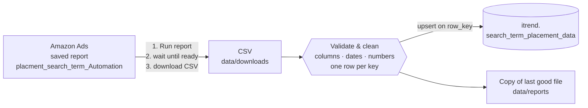

# Amazon Ads Placement Search Term → MySQL


This job keeps **`itrend.search_term_placement_data`** up to date with daily Amazon Ads placement and search-term performance.

Every hour it opens the saved Amazon Ads report **`placment_search_term_Automation`**, runs it, downloads the CSV, and writes the rows to MySQL. Each run refreshes the days in the report's period, so late-arriving sales and spend keep flowing into rows that are already stored. A row is never stored twice.

> **In short:** one row per *day × marketplace × campaign × ad group × target × product × search term × placement*, refreshed every hour, with no duplicates.

---

## Contents

1. [How it works](#how-it-works)
2. [What's in the table](#whats-in-the-table)
3. [Getting started](#getting-started)
4. [Everyday commands](#everyday-commands)
5. [Checking that it works](#checking-that-it-works)
6. [How duplicates are prevented](#how-duplicates-are-prevented)
7. [Configuration](#configuration)
8. [Troubleshooting](#troubleshooting)
9. [Exit codes](#exit-codes)
10. [Project layout](#project-layout)
11. [Development](#development)

---

## How it works



| Step | What happens |
| --- | --- |
| **1. Run** | A headless Chromium opens the report's history page with the saved Amazon session and clicks **Run report**. |
| **2. Wait** | The page is checked every 30 s until the run is ready (up to 15 min). |
| **3. Download** | The CSV is downloaded and checked: it must be a real report with the expected columns. |
| **4. Clean** | IDs become exact integers, money and counts become numbers, and blank text becomes `NULL`. Rows outside the allowed date range are refused. |
| **5. Write** | Rows go to MySQL in batches of 50,000, each committed on its own. New rows are inserted, and rows already stored get the latest numbers. |

The scheduled task runs **every hour at :15 IST**. Only one run can happen at a time: if the previous run is still busy, the next one skips (exit code `11`) and tries again an hour later.

---

## What's in the table

### Where each day's data came from

| Dates | Source | How to recognise the rows |
| --- | --- | --- |
| **Up to 17 Nov 2026** | The previous loader (historic data, kept as it was) | `row_key IS NULL` |
| **From 18 Nov 2026** | This job, refreshed hourly | `row_key IS NOT NULL` |

The job never writes rows dated before 18 Nov 2026, because `LOAD_FROM_DATE=2026-11-18` is set in `.env`. That keeps the historic days from being loaded a second time.

### Columns

| Column | Type | From the report column |
| --- | --- | --- |
| `id` | BIGINT, auto-increment | — |
| `date` | DATE | Date |
| `campaign_id`, `campaign_name` | BIGINT, VARCHAR | Campaign ID, Campaign name |
| `campaign_country` | VARCHAR | Campaign country (`US`, `CA`, `GB`, `DE`, `MX`, `IT` …) |
| `ad_group_id`, `ad_group_name` | BIGINT, VARCHAR | Ad group ID, Ad group name |
| `portfolio_name` | VARCHAR | Portfolio name |
| `advertised_product_id`, `advertised_product_marketplace` | VARCHAR | Advertised product ID / marketplace |
| `targeting`, `targeting_match_type` | TEXT, VARCHAR | Targeting, Targeting match type |
| `target_bid`, `target_status` | DECIMAL, VARCHAR | Target bid, Target status |
| `search_term` | TEXT | Search term |
| `placement_classification` | VARCHAR | Placement classification |
| `budget_currency` | VARCHAR | Budget currency |
| `impressions`, `clicks` | BIGINT | Impressions, Clicks |
| `spend` | DECIMAL | **Total cost** |
| `purchases`, `purchases_multi_touch` | BIGINT, DECIMAL | Purchases, Purchases (multi-touch) |
| `sales`, `sales_multi_touch` | DECIMAL | Sales, Sales (multi-touch) |
| `units_sold`, `units_sold_multi_touch` | BIGINT, DECIMAL | Units sold, Units sold (multi-touch) |
| `report_id` | VARCHAR(36) | The Amazon saved report the row came from |
| `loaded_at` | DATETIME (UTC) | When a run last wrote the row |
| `row_key` | CHAR(64), **UNIQUE** | Fingerprint of the row's identity (see [below](#how-duplicates-are-prevented)) |

> [!NOTE]
> The report also has **Campaign budget amount, Campaign delivery status, Target ID, Target type** and **Portfolio ID**. The table has no columns for these, so they are skipped, and every run logs a warning that says so. To keep one of them, add a column with the snake_case name (for example `ALTER TABLE … ADD COLUMN target_id BIGINT NULL`). The next run fills it automatically.

---

## Getting started

### What you need

- Windows 10/11 (or a Linux server, see below), **Python 3.11+** and **[uv](https://docs.astral.sh/uv/)**
- Network access to the itrend MySQL server
- An Amazon Ads login that can open the saved report

### Setup (Windows)

```powershell
# 1. Install the dependencies and the browser
uv sync
uv run playwright install chromium

# 2. Fill in the settings (only DB_PASSWORD is normally missing)
copy .env.example .env
notepad .env

# 3. Check the settings (opens no browser and touches no database)
uv run python run.py --check-config

# 4. Sign in to Amazon once: a browser window opens; sign in and enter the OTP
uv run python run.py --login

# 5. Try one run by hand
uv run python run.py --load

# 6. Schedule it every hour at :15
powershell -ExecutionPolicy Bypass -File scripts\install_task_windows.ps1
```

| To… | Run |
| --- | --- |
| Use a different minute | `scripts\install_task_windows.ps1 -Minute 30` |
| Remove the scheduled task | `scripts\install_task_windows.ps1 -Remove` |

> [!NOTE]
> The scheduled task runs while you are signed in to Windows. The Amazon session in `data\session` belongs to this Windows user.

### Setup (Linux server with cron)

```bash
uv sync --no-dev && uv run playwright install --with-deps chromium
cp .env.example .env && chmod 600 .env       # fill in DB_PASSWORD
chmod +x scripts/*.sh

uv run python run.py --login                 # one-time sign-in (asks for the OTP)
scripts/install_cron.sh --print              # checks the setup and shows the cron line
scripts/install_cron.sh                      # installs it
```

> [!IMPORTANT]
> Schedule the job on **one machine only**. If you move it to a server, remove the Windows task first.

---

## Everyday commands

| I want to… | Command | Writes to MySQL? |
| --- | --- | --- |
| **Run now** (same as the scheduled task) | `uv run python run.py --load` | ✅ Yes |
| Try the whole flow without writing | `uv run python run.py --load --dry-run` | ❌ No |
| Only download the report | `uv run python run.py --save-reports` | ❌ No |
| Use the newest finished run instead of clicking *Run* | `uv run python run.py --load --latest` | ✅ Yes |
| Load a CSV I already have | `uv run python run.py --process-file "C:\path\report.csv"` | ✅ Yes |
| Check the `.env` settings | `uv run python run.py --check-config` | ❌ No |
| Sign in to Amazon again | `uv run python run.py --login` | ❌ No |
| Test the page selectors (clicks nothing) | `uv run python run.py --inspect-page --headed` | ❌ No |

### Upsert or insert?

| Mode | What happens to a row that is already stored | When to use it |
| --- | --- | --- |
| `upsert` (**default**) | Updated with the newest numbers | Almost always. Amazon keeps adding sales to recent days, and upsert picks those up. |
| `insert` (`--load-mode insert`) | Left unchanged; only new rows are added | Only when existing rows must not change. |

Every run ends with a summary:

```text
  today     report     : data\reports\amazon_ad_placement_search_term_today.csv (777141 rows)
  today     covers     : 2026-11-18 [CA, DE, GB, MX, US]; 2026-11-19 [...]; 2026-11-20 [...]
  today     database   : upsert: 1124 inserted, 776017 updated
  status             : SUCCESS
```

---

## Checking that it works

| Where | What you should see |
| --- | --- |
| `logs\placement_search_term_cron.log` | A `START` and an `END status=0 SUCCESS` line for each run. |
| `logs\placement_search_term_cron_last_run.log` | The full output of the last run. |
| `logs\placement_search_term.log` | The detailed log, rotated daily and kept for 14 days. |
| `data\reports\amazon_ad_placement_search_term_today.csv` | The last file that loaded successfully. |
| Task Scheduler → *Amazon Placement Search Term* | *Last Run Result* `0x0`. |

### Useful SQL

**Rows and totals per day.** Every day should appear exactly once:

```sql
SELECT date,
       COUNT(*)           AS rows_,
       SUM(impressions)   AS impressions,
       SUM(clicks)        AS clicks,
       SUM(spend)         AS spend,
       SUM(sales)         AS sales,
       MAX(loaded_at)     AS last_loaded_utc
  FROM itrend.search_term_placement_data
 GROUP BY date
 ORDER BY date DESC;
```

**Duplicate check.** This must return no rows:

```sql
SELECT row_key, COUNT(*)
  FROM itrend.search_term_placement_data
 WHERE row_key IS NOT NULL
 GROUP BY row_key
HAVING COUNT(*) > 1;
```

---

## How duplicates are prevented

Each row is identified by its **natural key**:

> `date` · `campaign_country` · `campaign_id` · `ad_group_id` · `targeting` · `targeting_match_type` · `advertised_product_id` · `search_term` · `placement_classification`

The SHA-256 of those values is stored in `row_key`, which has a **UNIQUE index**, so MySQL itself refuses a second copy.

| Rule | What it means for you |
| --- | --- |
| **One row per key** | Running the same day again updates the row instead of adding a new one. |
| **Checked after every batch** | After each write, the number of rows for those keys must equal the number of keys. If it doesn't, that batch is rolled back. |
| **Clean files only** | If two rows in one file share a key but have different numbers, the whole file is refused, nothing is written, and the log names the column that differs. Exact copies are simply dropped. |
| **Nothing is deleted** | The job only inserts and updates rows. A row that Amazon later drops stays in the table. |
| **Stable key** | If the report loses a key column, the run stops instead of loading rows under a different key. |
| **One run at a time** | A run lock prevents two runs from writing at once. |

> [!TIP]
> Historic rows (up to 17 Nov 2026) have no `row_key`. That's expected: they came from the previous loader, before keys existed, and this job never touches them.

---

## Configuration

All settings are in **`.env`**; copy it from `.env.example`. Environment variables override the file.

### Most important settings

| Setting | Current value | What it does |
| --- | --- | --- |
| `DB_HOST`, `DB_PORT`, `DB_USER`, `DB_PASSWORD` | itrend server | MySQL login. It needs SELECT, INSERT and UPDATE on the table (see `sql/grant_access.sql`). |
| `DB_NAME` | `itrend` | Must be `itrend`; any other value is refused. |
| `DB_LOAD_MODE` | `upsert` | `upsert` or `insert` (see [above](#upsert-or-insert)). |
| `DB_COMMIT_EVERY_ROWS` | `50000` | Commit size. A run that stops halfway keeps the batches already committed and continues on the next run. |
| `LOAD_FROM_DATE` | `2026-11-18` | Rows dated before this day are never loaded. Leave it blank to load every date. |
| `REPORT_ID_TODAY` | `79745ecf-…` | The saved report's `reportId`. |
| `AMAZON_ENTITY_ID` | `ENTITY1YST5GXMAIR36` | The advertiser account. |
| `AMAZON_ACCOUNT_TIMEZONE` | `America/Los_Angeles` | Where the account's "day" begins and ends. |
| `MAX_REPORT_AGE_DAYS` | `95` | Refuse files with rows older than this. |
| `HEADLESS` | `true` | Set it to `false` to watch the browser. |
| `LOG_RETENTION_DAYS` / `FILE_RETENTION_DAYS` | `14` / `3` | How long logs and downloaded files are kept. |

Every other setting is explained in `.env.example`.

> [!CAUTION]
> `.env` holds the database password, and `data\session` holds the Amazon sign-in. Both are git-ignored. Never commit or share them.

### Report period and run time

The saved report currently covers **the last 7 days**, about 780,000 rows. A full run takes about **70 minutes**, so roughly every other hourly run is skipped while the previous one finishes. That's harmless, because each successful run refreshes all 7 days.

For faster runs, change the saved report's period in Amazon Ads (*Report settings*) to a shorter range, such as *Last 3 days*. Keep at least 2–3 days so late-arriving sales are still picked up.

---

## Troubleshooting

<details>
<summary><b>"Another placement search term run is in progress" (exit 11)</b></summary>

A run is already loading. This is normal with a 7-day report: a run takes about 70 minutes. Wait for it to finish (watch `logs\placement_search_term.log` for `upsert progress: … (NN%)`). **Don't delete the lock file.** The lock is released automatically when the run ends, even after a crash.
</details>

<details>
<summary><b>Exit 3 every hour: Amazon needs a sign-in</b></summary>

The saved Amazon session has expired. Run `uv run python run.py --login`, sign in, and enter the OTP. Tick *Don't require code on this browser* so later runs don't ask again.
</details>

<details>
<summary><b>"The finished run shows no download control"</b></summary>

The report has no finished run yet. This usually happens with `--latest` on a report that has never been run. Run without `--latest` so the job clicks *Run* first. If the page layout changed, run `uv run python run.py --inspect-page --headed` and update `config/selectors.json`. A screenshot of the page is saved in `data\screenshots`.
</details>

<details>
<summary><b>"row(s) repeat the same …, differ in: X" (exit 8)</b></summary>

The report contains a column that tells rows apart but isn't part of the key. If that column identifies a row, add it to `key_columns` in `app/placement_processor.py` (and add a test). Nothing was written.
</details>

<details>
<summary><b>"Column(s) not in the table, not stored: …"</b></summary>

This is a warning, not an error. The report has columns that the table doesn't store. Add a matching column to the table if you want to keep them (see [Columns](#columns)).
</details>

<details>
<summary><b>"… is missing column(s) report_id, loaded_at, row_key"</b></summary>

The table doesn't have the loader's columns. `sql/migrate_search_term_placement_data.sql` adds them without changing any existing row. It has already been applied to the live table.
</details>

<details>
<summary><b>Exit 9: database error</b></summary>

Check the network connection to the MySQL server and the error in the log. Only the current batch is rolled back; batches already committed stay, and the next run continues from there.
</details>

---

## Exit codes

| Code | Meaning | What to do |
| --- | --- | --- |
| `0` | Success | Nothing |
| `2` | Configuration error | `run.py --check-config` |
| `3` | Amazon needs a person (expired session, OTP, CAPTCHA) | `run.py --login` |
| `4` / `6` | Page or download problem | See the screenshot in `data\screenshots` |
| `7` | The CSV isn't the expected report | Check the saved report's columns |
| `8` | Bad values, or rows repeating a key | Read the log; it names the column |
| `9` | Database error (that batch was rolled back) | Check the connection and the log |
| `11` | Another run is in progress | Wait; the next hourly run retries |
| `12` | Invalid report ID | Check `REPORT_ID_TODAY` |
| `13` | Amazon didn't finish the report in time | Wait; the next hourly run retries |
| `14` | Dates outside `MAX_REPORT_AGE_DAYS` | Check the report period |
| `16` | A report wasn't loaded | See the run summary in the log |

---

## Project layout

```text
run.py                           Command-line entry point
app/
  main.py                        The load / download / process-file flows
  placement_processor.py         CSV → rows: column mapping, cleaning, natural key, row_key
  database.py                    Table checks and the upsert on row_key
  report_history.py              Amazon report page: Run, wait, Download
  auth.py, browser.py            Amazon sign-in and the saved browser session
  config.py                      Settings from .env
  report_csv.py                  CSV reading, number and date parsing
  retry.py, runlock.py           Retries and the one-run-at-a-time lock
  logging_config.py              Console and rotating file logs (passwords masked)
config/selectors.json            Page selectors for the Amazon report page
scripts/
  install_task_windows.ps1       Windows Task Scheduler setup (hourly at :15)
  run_placement_search_term.ps1  Windows wrapper used by the task
  install_cron.sh                Linux cron setup
  run_placement_search_term.sh   Linux wrapper used by cron
sql/
  migrate_search_term_placement_data.sql  Adds report_id / loaded_at / row_key (applied 2026-11-20)
  grant_access.sql               Optional dedicated MySQL login
tests/                           pytest suite (needs no Amazon or MySQL)
data/                            Session, downloads, reports, screenshots (git-ignored)
logs/                            Run logs (git-ignored)
```

---

## Development

```powershell
uv sync           # installs dependencies, including pytest
uv run pytest     # runs the tests (no Amazon or MySQL needed)
```

Before changing how rows are identified (`key_columns` in `app/placement_processor.py`), remember that `row_key` values already stored were computed with the current key. A different key gives different `row_key` values, and the next run would insert the same days again as new rows.
